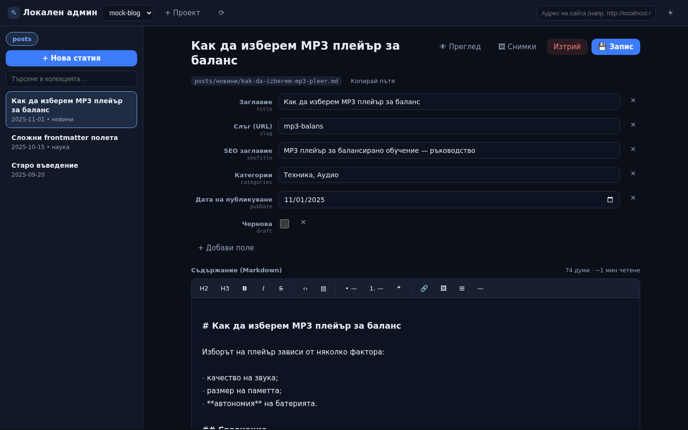
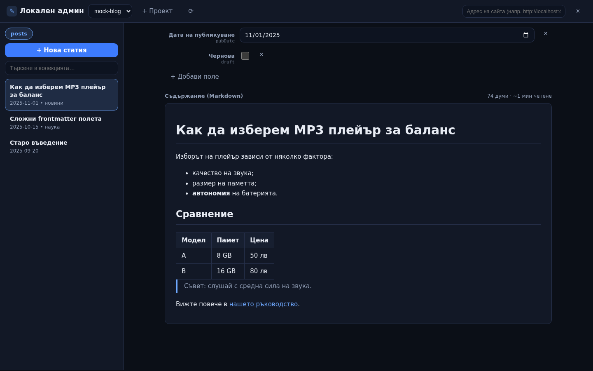

# 📝 Локален админ панел

> Хранилище: **https://github.com/fedya-dev/local-admin**

Лек панел за писане и редакция на статии в статични сайтове (Astro, Hugo-подобни,
Eleventy и др.). Работи **изцяло локално**: пускаш го от папката му, отваряш адрес
в браузъра и той чете/записва файловете на проекта **директно на диска**.

- ❌ никакъв облак, Git-бектенд или CDN
- ❌ никакви npm инсталации — само вградени модули на Node (трябва Node 18+)
- ❌ никакво объркване между сайтовете — всеки проект е изрично избран от списък
- ✅ списък + редакция, нови статии, изтриване (с кош), качване на снимки, преглед
- ✅ лента за форматиране: болд, курсив, код, списъци, цитат, връзка, таблица
- ✅ редакторът оцветява Markdown на живо: заглавията са удебелени и по-едри,
  болд/курсив/код/линковете се виждат веднага, докато пишеш
- ✅ полетата идват от схемата на проекта (`content.config.ts`, zod) — heroImage,
  seoTitle, категории…; редактори по тип: дата, да/не, списък, избор, снимка
- ✅ тъмна тема по подразбиране (+ светла — бутон ☀/🌙 горе вдясно)
- ✅ при запис показва пълния път на файла с „Копирай пътя“ и връзка към сайта
- ✅ открива проектите автоматично (Desktop, Documents), но можеш да добавиш и по път
- ✅ интерфейс на български

## Как изглежда

Редакторът с оцветяване на Markdown на живо — заглавията са удебелени веднага,
болд/курсив/линковете се виждат, докато пишеш:



Същата статия в режим „Преглед“ (рендериран Markdown):



## Пускане

```bash
cd local-admin
node admin.mjs
```

После отвори **http://localhost:4870** в браузъра (по подразбиране порт 4870;
друг порт: `node admin.mjs --port 4871`).

В Windows (WSL):

```bash
cd /mnt/c/Users/<твоето-име>/Desktop/local-admin
node admin.mjs
```

Има и `./start.sh` (WSL/Linux/macOS) и `start.bat` (Windows с инсталиран Node).

## Как работи

1. **Откриване на проекти** — при всяко пускане панелът търси папки с
   `package.json` (зависимост `astro`) или `astro.config.*` в Desktop, Documents
   и home папката (до 2 нива навътре). Бутонът **⟳** търси отново.
2. **Добавяне по път** — бутонът **+ Проект** приема пълен път до папката на
   проекта (папката с `package.json`). Проектът се запомня в
   `local-admin.config.json` (създава се сам при първото пускане).
3. **Колекции** — панелът намира папките със `.md` съдържание: подпапки на
   `src/content/` (Astro, вкл. прочетени от `content.config.ts`), `content/`
   (Hugo/Zola) или `src/posts`, `src/blog` и др.
4. **Полета на формата** — от три места, обединени: **схемата** на проекта
   (`content.config.ts` с zod → типове: текст, дата, да/не, списък, избор,
   снимка), frontmatter ключовете от съществуващите статии и стандартен набор
   (title, pubDate, heroImage, seoTitle…). „+ Добави поле“ отваря списък с
   търсене. Непознати/вложени YAML блокове се показват като „Разширено“ и се
   запазват **дословно** — нищо не се разваля.
5. **Запис** — пише файла директно. След запис се показва зелена лента с пълния
   път на файла, бутон „Копирай пътя“ и връзка „↗ Виж в сайта“ (ако е зададен
   адрес на сайта). Ако смениш категория или слъг, файлът се премества.
   Съществуващ файл не се презаписва без потвърждение.
6. **Изтриване** — файлът отива в `.trash-local-admin/` в корена на проекта
   (можеш да го върнеш оттам). Нищо не се изтрива безвъзвратно.
7. **Снимки** — качват се в медийна папка (автоматично: първата съществуваща от
   `public/images/uploads`, `public/uploads`, `public/images`, `public/img`…;
   ако няма — се създава `public/uploads`). В текста се вмъква пътят за сайта,
   напр. ``. Можеш да зададеш и друга папка
   (с лицензия: редактирай `mediaDir` в `local-admin.config.json`).
8. **Преглед** — рендерира Markdown в панела (заглавия, списъци, таблици, код,
   връзки, снимки). Качени снимки се виждат още преди изграждането на сайта.

## Сигурност

- Слуша **само на 127.0.0.1** — няма достъп от мрежата.
- Няма парола/авторизация: това е инструмент за твоята машина. Не го излагай
  в мрежа (без port forwarding, тунели или public хостинг).
- Работи само с папки, изрично добавени като проекти, и само вътре в тях
  (`../` излизащи пътища се отхвърлят).

## За колеги: бърз старт (Git/GitHub)

```bash
git clone https://github.com/fedya-dev/local-admin
cd local-admin
node admin.mjs        # → http://localhost:4870
```

- Не е нужен `npm install` — няма зависимости, трябват само Node 18+.
- Всеки си пуска **своето копие локално**; списъкът с проекти
  (`local-admin.config.json`) е личен и е в `.gitignore` — не се комитва.
- Първи път: бутона **+ Проект** с пътя до папката на сайта (или изчакай
  автоматичното откриване).
- Дръж съдържанието на сайта в Git: панелът пише директно във файловете, така
  че промените минават през обичайния commit/push поток и се виждат в разликите.

## Бележки

- Ако имаш пуснат `npm run dev` на проекта, промените се виждат веднага
  (hot reload) — панелът е просто приятен редактор на файловете.
- `local-admin.config.json` пази списъка с проекти, търсени папки (roots) и
  последния отворен проект. Може да се редактира на ръка.
- Държи проектите си в Git (или прави backup) — панелът е инструмент, не замяна
  на версионирането.

## Файлове

```
local-admin/
├─ admin.mjs            ← пускане: node admin.mjs
├─ server.mjs           ← HTTP сървър + API
├─ lib/frontmatter.mjs  ← YAML frontmatter парсер/записвач
├─ lib/projects.mjs     ← откриване на проекти и колекции
├─ public/              ← интерфейсът (index.html, app.js, style.css)
├─ docs/                ← скрийншоти за README
├─ start.sh / start.bat ← удобни стартери
└─ README.md
```
